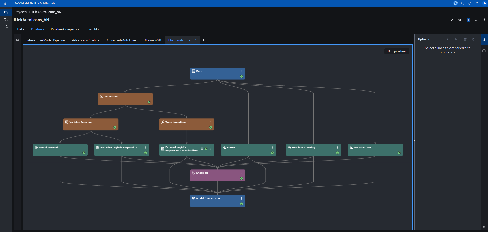
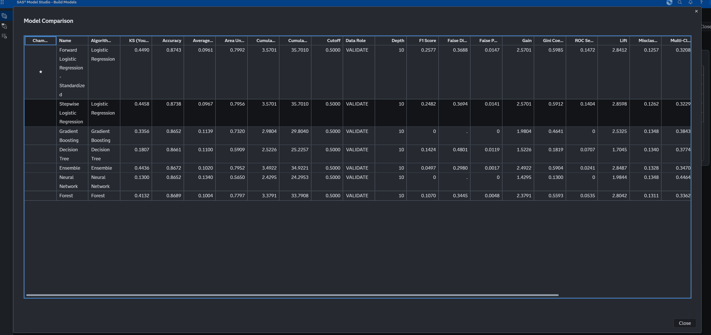
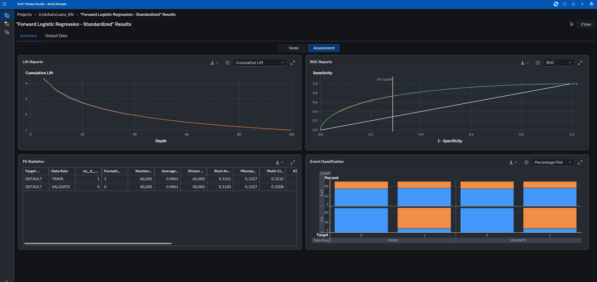
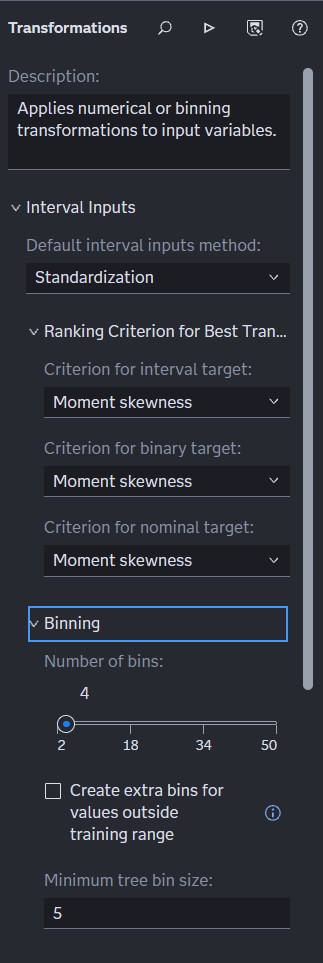
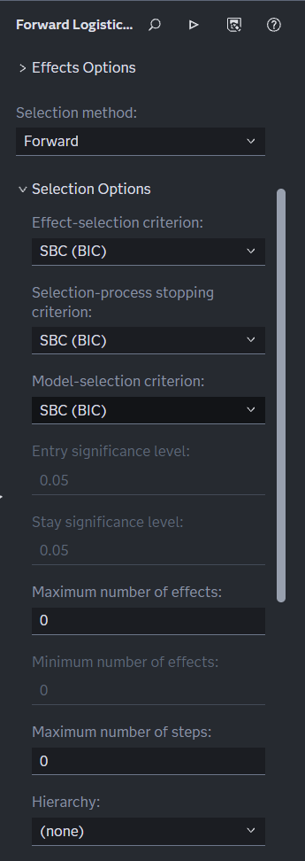
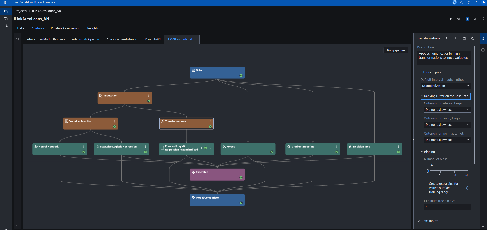
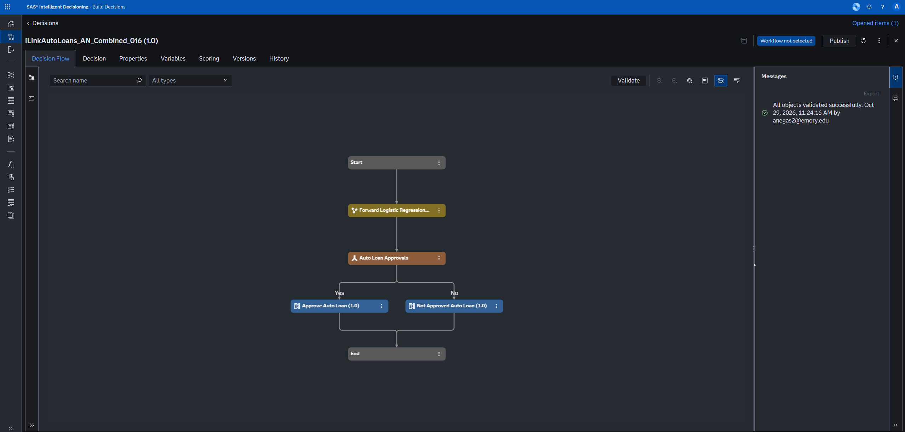
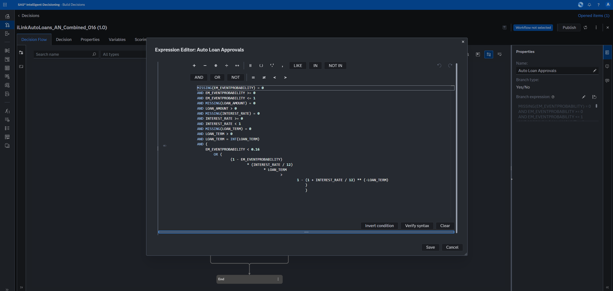
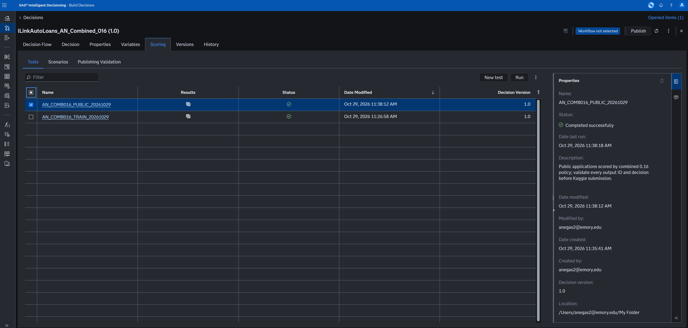
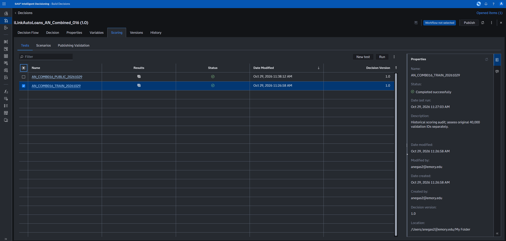

# SAS workflow

I used Model Studio to develop the default-risk model, Model Manager to register it, and Intelligent Decisioning to turn the predictions into approval decisions. This page covers that part of the hackathon work.

```text
Model Studio: compare and select a model
    ↓
Model Manager: register model v1.1
    ↓
Intelligent Decisioning: score and apply approval rules
    ↓
Historical and public scoring outputs
    ↓
Python: compare policies and validate the CSV
```

## Model Studio

I used 100,000 historical loans and a stratified 60% training / 40% validation partition. The target was `DEFAULT`, with `1` representing default. `LOAN_ID` was kept for matching records and excluded from model inputs.

I compared logistic regression, decision tree, forest, gradient boosting, neural network, and ensemble models on the same partition. The selected path used Imputation, a Transform node to standardize interval inputs, and Forward Logistic Regression. Categorical inputs remained categorical.



The pipeline shows the separate model branches and the Model Comparison node used to assess them.

| Setting | Value |
| --- | --- |
| Training / validation records | 60,000 / 40,000 |
| Target event | `DEFAULT = 1` |
| Distribution / link | Bernoulli / logit |
| Selection method | Forward |
| Selection, stopping, and final model criterion | SBC |
| Registered model version | 1.1 |

The original logistic fit produced 13 information-matrix warnings. I added interval standardization and reran the model. Both fits met the convergence criterion, but the standardized fit produced none of those information-matrix warnings.

The selected model had training AUC 0.7975 and validation AUC 0.7992. The other assessment figures are in the [README](../README.md#model-results).



In this pipeline comparison, the standardized logistic model is marked as champion, with validation AUC 0.7992 and KS 0.4490. The gradient boosting row is the default run; the separate manual trial is discussed in the [methodology](methodology.md#model-development).



The assessment view shows the training and validation curves and fit statistics. Its classification cutoffs are separate from the loan-approval cutoffs used in Intelligent Decisioning.

### Standardization and model-selection settings

The Transformations node uses **Standardization** as the default interval-input method. The logistic node uses **Forward** selection and **SBC (BIC)** for effect selection, stopping, and choosing the final model.

| Transformations settings | Logistic selection settings |
| --- | --- |
|  |  |

<details>
<summary>Standardization settings in the full pipeline</summary>



</details>

The saved node logs are `Log for Node _Forward Logistic Regression_.log` and `Log for Node _Forward Logistic Regression - Standardized_.log`. They record the model settings and the change in information-matrix warnings.

## Model Manager

I registered the standardized logistic model in Model Manager as version 1.1. The scoring path applies the imputation and standardization steps before prediction.

The approval-policy comparisons used this same registered model. Changing the approval cutoff changed the decisions rather than retraining the model.

## Intelligent Decisioning

I built separate decision flows for the initial cutoff, the value-only policy, and the combined policy. The combined rule approves a loan when its predicted default probability is below the cutoff or its expected loan value is positive.

The later decision is `iLinkAutoLoans_AN_Combined_016`, decision version 1.0. It uses model version 1.1 and a 0.16 probability cutoff.



The model feeds the Auto Loan Approvals branch. The Yes path goes to Approve Auto Loan, and the No path goes to Not Approved Auto Loan. The validation message confirms that all objects validated successfully.

```text
Application inputs
    ↓
Preprocessing and registered logistic model
    ↓
Predicted default probability
    ↓
Valid inputs and combined approval condition?
    ├─ True  → Approval rule set → APPROVED = 1
    └─ False → Decline rule set  → APPROVED = 0

Both paths produce a scoring output with LOAN_ID.
```

The value calculation uses principal, annual interest rate, and loan term in months to calculate scheduled full-term interest. It assumes that repayers pay the scheduled interest and defaults lose the original principal. The [methodology](methodology.md#initial-cutoff-evaluation) explains those assumptions.

The combined rule can be read as:

```text
If the required inputs are valid:
    Approve when PD < 0.16
    or (1 - PD) * scheduled interest - PD * principal > 0.
Otherwise decline.
```

The branch expression below is the SAS condition used for the combined 0.16 flow. The true path goes to the approval rule set, and the false path goes to the decline rule set.



<details>
<summary>Combined 0.16 SAS branch expression</summary>

```sas
MISSING(EM_EVENTPROBABILITY) = 0
AND EM_EVENTPROBABILITY >= 0 AND EM_EVENTPROBABILITY <= 1
AND MISSING(LOAN_AMOUNT) = 0 AND LOAN_AMOUNT > 0
AND MISSING(INTEREST_RATE) = 0
AND INTEREST_RATE >= 0 AND INTEREST_RATE < 1
AND MISSING(LOAN_TERM) = 0
AND LOAN_TERM > 0 AND LOAN_TERM = INT(LOAN_TERM)
AND (
    EM_EVENTPROBABILITY < 0.16
    OR (
        (1 - EM_EVENTPROBABILITY) * (INTEREST_RATE / 12) * LOAN_TERM
        > 1 - (1 + INTEREST_RATE / 12) ** (-LOAN_TERM)
    )
)
```

</details>

The checks reject missing or out-of-range probabilities and invalid loan inputs. The value condition uses the amortizing-loan calculation rather than principal multiplied by annual rate and term.

## Scoring tests

I validated the decision and ran separate historical and public scoring tests in Intelligent Decisioning. Both tests completed successfully using decision version 1.0.



Both tests show successful status. The public test details show that it completed on October 29 using decision version 1.0.

<details>
<summary>Historical scoring test details</summary>



</details>

| Test | Input | CASUSER output table |
| --- | --- | --- |
| `AN_COMB016_TRAIN_20261029` | `CREDITr.ILINK_CREDITRISK_TRAINING` | `AN_COMBINED_016_TRAIN_20261029` |
| `AN_COMB016_PUBLIC_20261029` | `CREDITr.ILINK_CREDITRISK_SCORING_PUBLIC` | `AN_C016_PUBLIC_20261029_R2` |

All 43 required inputs were mapped in the tests. I preserved the unmapped columns so that `LOAN_ID` stayed in the output. This input-mapping count is separate from the number of candidate predictors used during model development.

The public test was rerun with a fresh output name after a table-name collision. The final output is the R2 table listed above.

| Scoring result | Count |
| --- | ---: |
| Historical loans scored | 100,000 |
| Approvals in the original 40,000-loan validation partition | 28,905 |
| Defaults among validation approvals | 1,832 |
| Scoring applications processed | 100,000 |
| Approved scoring applications | 72,135 |
| Additional scoring approvals compared with 0.14 | 3,324 |

I exported the historical and public scoring tables through Visual Analytics using detailed, unformatted CSV exports. The full exports remain local.

## Python checks after SAS scoring

The [CSV preparation script](../scripts/prepare_sas_submission.py) joins the new SAS exports to the 0.14 baseline by `LOAN_ID`. It checks unchanged probabilities within the older export's rounding precision and verifies that each new decision matches the old approval or the higher cutoff.

It then keeps `LOAN_ID` and `APPROVED` and calls the [CSV validator](../scripts/validate_submission.py). The validator checks column order, 100,000 rows, unique integer IDs, binary decisions, and exact coverage of the official scoring IDs.

The model development, preprocessing, and decision scoring were done in SAS. Python handled the policy analysis and checks on the exported files.

The same validation partition informed model and policy selection. The [methodology](methodology.md#evaluation-limits) records the evaluation and reproduction limits.
